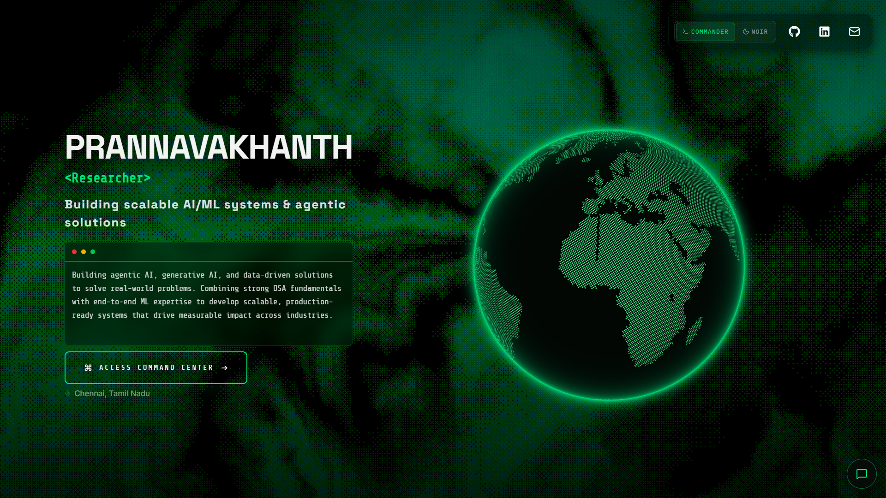
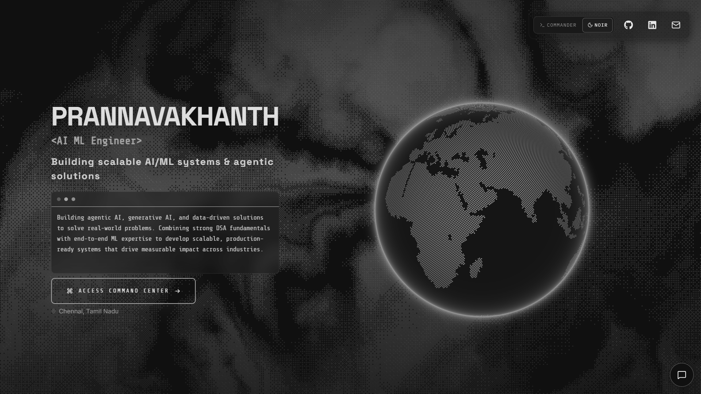
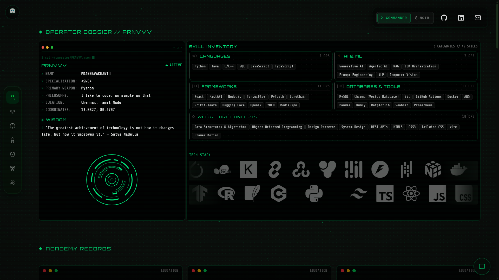
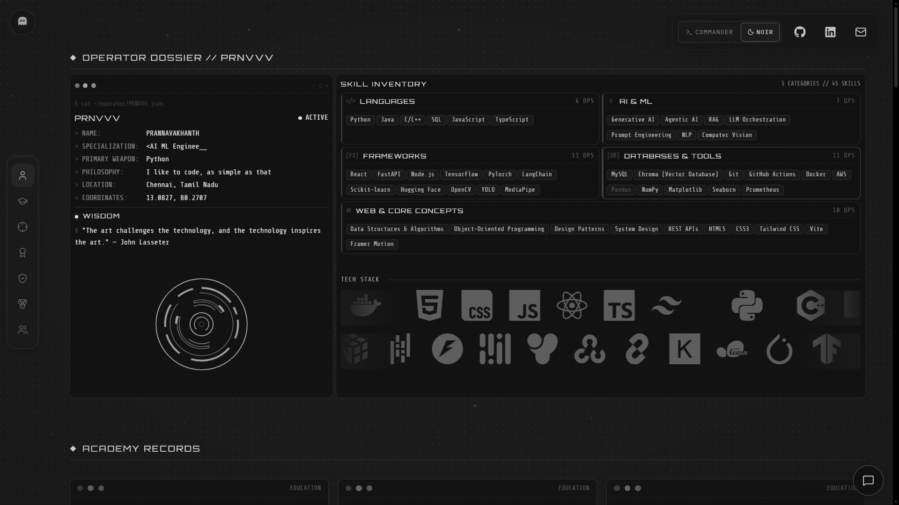
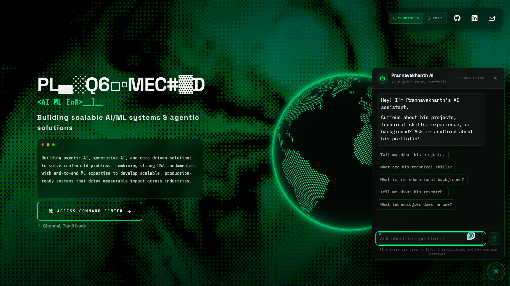
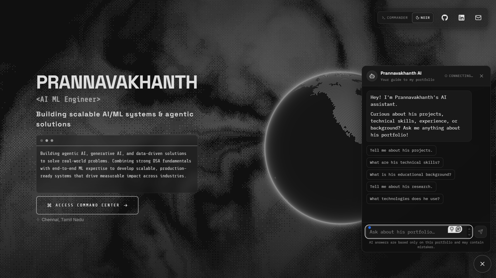

<!-- README HEADER IMAGE — Add assets/readme/readme_header.<extension> here (note: the screenshots folder in this repo is currently spelled `assests/readme/`) -->

# Prannavakhanth A. — Developer Portfolio

**A terminal-inspired, HUD-style portfolio with an interactive 3D globe, two switchable themes, and a RAG-powered AI assistant.**

[**Live Website →**](https://folio-website.vercel.app/)

---

## Overview

This is the personal developer portfolio of **Prannavakhanth A.** (GitHub: [`prnvvv`](https://github.com/prnvvv)), an AI/ML engineer, software developer and researcher working on agentic AI, generative AI, RAG and computer vision.

The site presents that work through a "command center" interface: a terminal-style landing page with a dotted 3D globe, an operator dossier, mission (project) records, a service-record timeline, and an **AI assistant** that answers questions about the portfolio from its own knowledge base.

Two visual modes share the exact same pages and layout:

- **Commander** — the original green HUD palette (default).
- **Noir** — a monochrome black-and-grayscale variant.

## Website Preview

<table>
  <tr>
    <td width="50%"></td>
    <td width="50%"></td>
  </tr>
  <tr>
    <td align="center"><b>Landing page — Commander</b></td>
    <td align="center"><b>Landing page — Noir</b></td>
  </tr>
</table>

## About the Portfolio

The goal is for the site to show engineering ability through its implementation as well as its content. The design follows a few rules:

- **Terminal language throughout.** Panels use a command-prompt title bar (`$ cat ...`), monospaced type (Share Tech Mono) and HUD-style section headers.
- **One layout, two themes.** Themes are CSS custom properties switched via a `data-theme` attribute that is set before first paint, so there is no flash of the wrong theme. The choice is persisted in `localStorage`.
- **Motion with purpose.** Animated globe, decrypting text, flickering grid, dithered background and a TV-style theme transition, built with Framer Motion, Three.js and canvas effects.
- **Responsive.** Desktop uses a side dock for section navigation; on small screens a bottom dock takes over.

## Features

<table>
  <tr>
    <td width="50%"></td>
    <td width="50%"></td>
  </tr>
  <tr>
    <td align="center"><b>Dashboard: Operator Dossier and Skill Inventory — Commander</b></td>
    <td align="center"><b>Dashboard — Noir</b></td>
  </tr>
</table>

| Area | What it does |
|---|---|
| **Landing page** (`/`) | Terminal-style intro, interactive dotted globe ([`cobe`](https://github.com/shuding/cobe)), social links, and a button into the command center. |
| **Dashboard** (`/dashboard`, `/command-center`) | Single page with a side dock that jumps between sections. |
| **Operator Dossier & Skill Inventory** | Profile card plus categorised skills and a tech-stack icon loop. |
| **Academy Records** | Education entries. |
| **Missions** (`/projects`, `/missions/all`) | Full project dossier, with figures for projects that have them. |
| **Service Record** | Vertical terminal-log timeline of experience. |
| **Credentials Vault** | Certifications, with certificate images and verification links. |
| **Commendations** | Achievements. |
| **Leadership & Roles** | Leadership positions. |
| **Commander / Noir themes** | Global theme switch with a TV-style transition, persisted across refreshes and routes. |
| **AI assistant** | Floating chat widget on every page, backed by a RAG API (see below). |
| **Responsive navigation** | Side dock on desktop, bottom dock on mobile. |

Portfolio content is static data in `ghost-protocol/frontend/src/data/`.

## AI Portfolio Assistant

A floating chat widget (bottom-right on every page) lets visitors ask about the owner's projects, skills, education, research, experience and background. It answers **only** from the portfolio's own knowledge base and refuses unrelated or adversarial prompts.

<table>
  <tr>
    <td width="50%"></td>
    <td width="50%"></td>
  </tr>
  <tr>
    <td align="center"><b>Assistant — Commander</b></td>
    <td align="center"><b>Assistant — Noir</b></td>
  </tr>
</table>

### How it works

1. **Knowledge base.** Portfolio facts live as JSON in `ghost-protocol/backend/data/` (personal, education, experience, projects, research, skills, achievements, FAQ). Nothing personal is hard-coded in prompts or code.
2. **Ingestion.** Files are loaded and validated, chunked, and stored in **ChromaDB**, which embeds them with its built-in local ONNX `all-MiniLM-L6-v2` model. No embedding API key is needed.
3. **Guardrails before the LLM.** Input checks, a prompt-injection detector and an intent classifier run first; rejected requests get a canned refusal and never reach the model.
4. **Retrieval.** The question is embedded and matched against ChromaDB (cosine similarity, top-k), then reranked. A context guard checks relevance and drops instruction-like chunks.
5. **Generation.** The retrieved context, a system policy and server-side chat history go to a **Groq**-hosted LLM (default model in `.env.example`: `openai/gpt-oss-120b`).
6. **Output validation.** An output guard checks for leaks, identity breaks, unsafe markup and grounding. On failure it regenerates once more strictly, otherwise returns a safe fallback.

The API also applies per-IP and per-session rate limits and a CORS allow-list. Full details: [`ghost-protocol/backend/README.md`](ghost-protocol/backend/README.md).

> No LLM guardrail is jailbreak-proof; the layered checks reduce risk rather than eliminate it.
