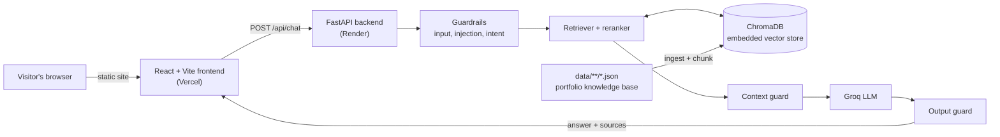

<!-- README HEADER IMAGE — Add assets/readme/readme_header.<extension> here (note: the screenshots folder in this repo is currently spelled `assests/readme/`) -->

<div align="center">

# Prannavakhanth A. — Developer Portfolio

**A terminal-inspired, HUD-style portfolio with an interactive 3D globe, two switchable themes, and a RAG-powered AI assistant.**

[**Live Website →**](https://folio-website.vercel.app/)


</div>

---

## Overview

This is the personal developer portfolio of **Prannavakhanth A.** (GitHub: [`prnvvv`](https://github.com/prnvvv)), an AI/ML engineer, software developer and researcher working on agentic AI, generative AI, RAG and computer vision.

The site presents that work through a "command center" interface: a terminal-style landing page with a dotted 3D globe, an operator dossier, mission (project) records, a service-record timeline, and an **AI assistant** that answers questions about the portfolio from its own knowledge base.

Two visual modes share the exact same pages and layout:

- **Commander** — the original green HUD palette (default).
- **Noir** — a monochrome black-and-grayscale variant.

## Website Preview

<table>
  <tr>
    <td width="50%"></td>
    <td width="50%"></td>
  </tr>
  <tr>
    <td align="center"><sub><b>Landing page — Commander</b></sub></td>
    <td align="center"><sub><b>Landing page — Noir</b></sub></td>
  </tr>
</table>

## About the Portfolio

The goal is for the site to show engineering ability through its implementation as well as its content. The design follows a few rules:

- **Terminal language throughout.** Panels use a command-prompt title bar (`$ cat ...`), monospaced type (Share Tech Mono) and HUD-style section headers.
- **One layout, two themes.** Themes are CSS custom properties switched via a `data-theme` attribute that is set before first paint, so there is no flash of the wrong theme. The choice is persisted in `localStorage`.
- **Motion with purpose.** Animated globe, decrypting text, flickering grid, dithered background and a TV-style theme transition, built with Framer Motion, Three.js and canvas effects.
- **Responsive.** Desktop uses a side dock for section navigation; on small screens a bottom dock takes over.

## Features

<table>
  <tr>
    <td width="50%"></td>
    <td width="50%"></td>
  </tr>
  <tr>
    <td align="center"><sub><b>Dashboard: Operator Dossier and Skill Inventory — Commander</b></sub></td>
    <td align="center"><sub><b>Dashboard — Noir</b></sub></td>
  </tr>
</table>

| Area | What it does |
|---|---|
| **Landing page** (`/`) | Terminal-style intro, interactive dotted globe ([`cobe`](https://github.com/shuding/cobe)), social links, and a button into the command center. |
| **Dashboard** (`/dashboard`, `/command-center`) | Single page with a side dock that jumps between sections. |
| **Operator Dossier & Skill Inventory** | Profile card plus categorised skills and a tech-stack icon loop. |
| **Academy Records** | Education entries. |
| **Missions** (`/projects`, `/missions/all`) | Full project dossier, with figures for projects that have them. |
| **Service Record** | Vertical terminal-log timeline of experience. |
| **Credentials Vault** | Certifications, with certificate images and verification links. |
| **Commendations** | Achievements. |
| **Leadership & Roles** | Leadership positions. |
| **Commander / Noir themes** | Global theme switch with a TV-style transition, persisted across refreshes and routes. |
| **AI assistant** | Floating chat widget on every page, backed by a RAG API (see below). |
| **Responsive navigation** | Side dock on desktop, bottom dock on mobile. |

Portfolio content is static data in `ghost-protocol/frontend/src/data/`.

## AI Portfolio Assistant

A floating chat widget (bottom-right on every page) lets visitors ask about the owner's projects, skills, education, research, experience and background. It answers **only** from the portfolio's own knowledge base and refuses unrelated or adversarial prompts.

<table>
  <tr>
    <td width="50%"></td>
    <td width="50%"></td>
  </tr>
  <tr>
    <td align="center"><sub><b>Assistant — Commander</b></sub></td>
    <td align="center"><sub><b>Assistant — Noir</b></sub></td>
  </tr>
</table>

### How it works

1. **Knowledge base.** Portfolio facts live as JSON in `ghost-protocol/backend/data/` (personal, education, experience, projects, research, skills, achievements, FAQ). Nothing personal is hard-coded in prompts or code.
2. **Ingestion.** Files are loaded and validated, chunked, and stored in **ChromaDB**, which embeds them with its built-in local ONNX `all-MiniLM-L6-v2` model. No embedding API key is needed.
3. **Guardrails before the LLM.** Input checks, a prompt-injection detector and an intent classifier run first; rejected requests get a canned refusal and never reach the model.
4. **Retrieval.** The question is embedded and matched against ChromaDB (cosine similarity, top-k), then reranked. A context guard checks relevance and drops instruction-like chunks.
5. **Generation.** The retrieved context, a system policy and server-side chat history go to a **Groq**-hosted LLM (default model in `.env.example`: `openai/gpt-oss-120b`).
6. **Output validation.** An output guard checks for leaks, identity breaks, unsafe markup and grounding. On failure it regenerates once more strictly, otherwise returns a safe fallback.

The API also applies per-IP and per-session rate limits and a CORS allow-list. Full details: [`ghost-protocol/backend/README.md`](ghost-protocol/backend/README.md).

> No LLM guardrail is jailbreak-proof; the layered checks reduce risk rather than eliminate it.

## Technology Stack

| Category | Technologies |
|---|---|
| **Frontend** | React 19, TypeScript 5.7, Vite 6, Tailwind CSS 4, React Router 7, Zustand, `react-markdown` |
| **Animation & 3D** | Framer Motion / `motion`, Three.js, React Three Fiber, `postprocessing`, `cobe` (globe), `canvas-confetti` |
| **UI utilities** | `lucide-react`, `react-icons`, `clsx`, `tailwind-merge`, `usehooks-ts` |
| **Backend** | Python 3.10–3.13, FastAPI, Uvicorn, Pydantic / pydantic-settings |
| **Vector database** | ChromaDB (local, persisted) with built-in ONNX `all-MiniLM-L6-v2` embeddings |
| **LLM** | Groq API (`groq` SDK) |
| **Testing** | pytest, httpx (backend); Node-based e2e scripts in `frontend/e2e/` |
| **Deployment** | Vercel (frontend), Render (backend) |
| **CI / tooling** | GitHub Actions (frontend build + `npm audit`), `tsc` strict type-checking |

## Architecture



- **Frontend** is a static, lazily-routed React app. Portfolio pages render from local data in `src/data/`; only the chat widget talks to the backend (`src/services/chatbotApi`).
- **Backend** exposes `/api/chat`, `/api/health` and an optional token-protected admin ingest endpoint. Handlers stay thin; orchestration lives in `services/chat_service.py`.
- **Data flow** for a question: guardrails → retrieval from ChromaDB → rerank → context guard → Groq → output guard → response.

More detail: [`ARCHITECTURE.md`](ARCHITECTURE.md).

## Responsive Design

The layout adapts across desktop, tablet and mobile widths:

- **Navigation** switches from a side dock on desktop to a fixed bottom dock on small screens (with safe-area padding for devices with a home indicator).
- **Dashboard sections** reflow from multi-column grids into stacked cards, and shared content width and spacing come from `styles/mobile-fixes.css`.
- **Theme switcher and social links** share one compact control in the top bar on narrow screens.
- **Chat widget** is available on every page at every width.

The screenshots above show the desktop (1920 × 1080) layout.

## Getting Started

**Prerequisites:** Node 20+, and Python 3.10–3.13 if you want to run the chatbot backend (3.12 recommended).

### Frontend

```bash
cd ghost-protocol/frontend
npm ci
npm run dev          # http://localhost:3000
```

Other scripts: `npm run typecheck`, `npm run build` (typecheck + production build), `npm run preview`.
The production build redirects HTTP to HTTPS, so test locally with `npm run dev`.

### Backend (AI assistant)

```bash
cd ghost-protocol/backend
python -m venv .venv && source .venv/bin/activate      # Windows: .venv\Scripts\activate
pip install -r requirements.txt
cp .env.example .env                                   # then set GROQ_API_KEY and ALLOWED_ORIGINS
python scripts/ingest.py                               # build the ChromaDB collection
uvicorn app.main:app --port 8000
python -m pytest -q                                    # tests (no network or LLM needed)
```

In development the frontend talks to `http://127.0.0.1:8000` automatically. Without a Groq key, `python scripts/dev_stub_server.py` runs real retrieval with a canned LLM. The first run downloads ChromaDB's ONNX model (~80 MB).

### Environment variables

Never commit real values. See the example files for the full list:

| File | Key variables |
|---|---|
| `ghost-protocol/backend/.env.example` | `GROQ_API_KEY`, `GROQ_MODEL`, `ALLOWED_ORIGINS`, `CHROMA_PERSIST_DIRECTORY`, `ADMIN_TOKEN` (optional) |
| `ghost-protocol/frontend/.env.example` | `VITE_CHATBOT_API_URL` (the chat widget is hidden in production when unset), `VITE_SITE_URL`, `VITE_SENTRY_DSN` |

More: [`DEVELOPMENT.md`](DEVELOPMENT.md), [`CONTRIBUTING.md`](CONTRIBUTING.md).

## Deployment

| Part | Platform | Notes |
|---|---|---|
| Frontend | **Vercel** | Configured in `ghost-protocol/frontend/vercel.json` (SPA rewrite, security headers, immutable asset caching). Set `VITE_CHATBOT_API_URL` at build time. |
| Backend | **Render** | Build: `pip install -r requirements.txt && python scripts/ingest.py`. Start: `uvicorn app.main:app --host 0.0.0.0 --port $PORT`. Health check: `/api/health`. Set `ALLOWED_ORIGINS` to the Vercel origin. |

Live site: **https://folio-website.vercel.app/**

## Contact

- GitHub: [github.com/prnvvv](https://github.com/prnvvv)
- LinkedIn: [linkedin.com/in/prannavakhanth](https://linkedin.com/in/prannavakhanth)
- Email: [prannavakhanth12@gmail.com](mailto:prannavakhanth12@gmail.com)

## License

MIT — see [`ghost-protocol/LICENSE`](ghost-protocol/LICENSE).
